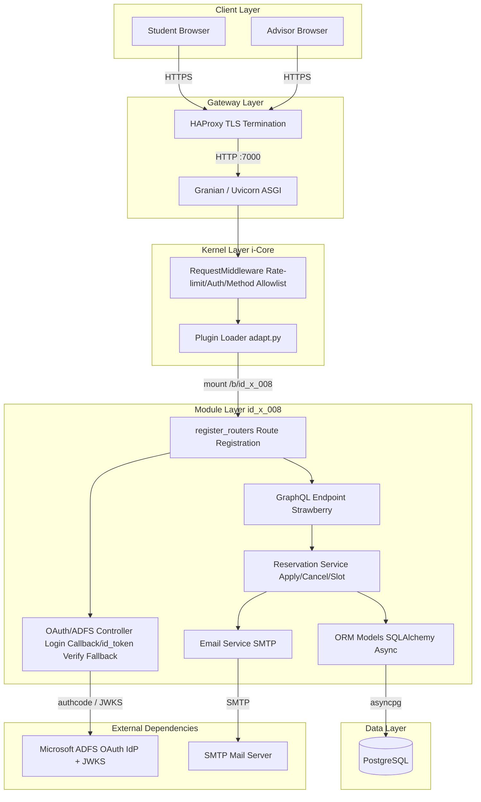
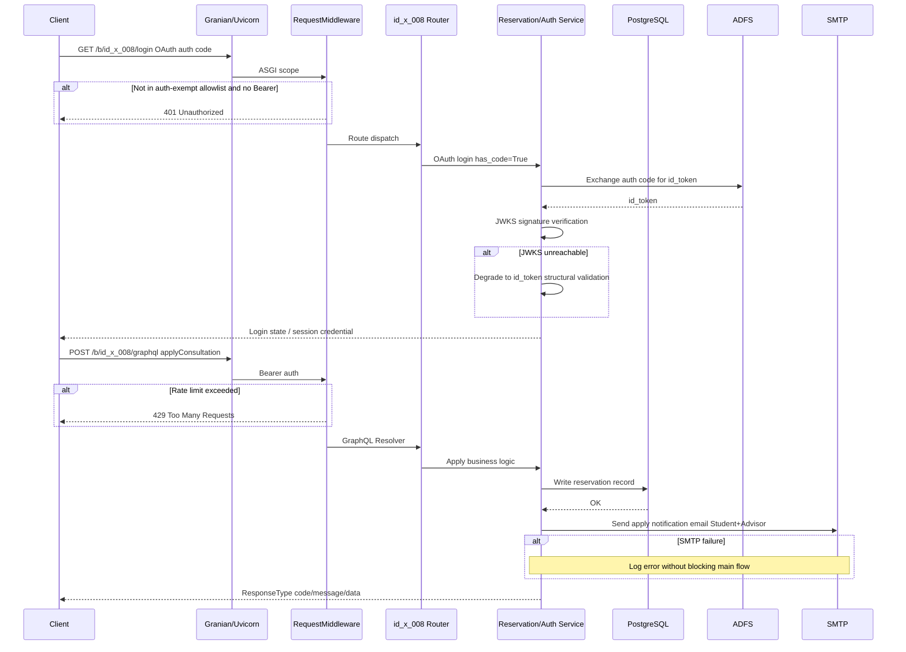

<div align="center">

# ID008: IAO Activity Reservation System

**Single Sign-On · Time-Slot Reservation · Bidirectional Email Notification — A One-Stop Career Consultation Booking Loop**


</div>

---

## 1. Introduction

- **Slogan**: Single Sign-On · Time-Slot Reservation · Bidirectional Email Notification — A One-Stop Career Consultation Booking Loop.
- **Description**: id_x_008 is a pluggable business module of the i-Core kernel, designed for career consultation booking scenarios in university career guidance centers. The module implements single sign-on via Microsoft ADFS (Active Directory Federation Services) OAuth; students can view advisor availability online and complete sign-ups and cancellations, while the system automatically sends SMTP email reminders to both students and advisors whenever a reservation changes state. The module exposes all business queries and mutations through a single Strawberry GraphQL endpoint, with data persisted to PostgreSQL via the SQLAlchemy async ORM. The module can either run as an i-Core engine plugin — with routing, database connection pooling, and security middleware managed centrally by the kernel — or run standalone, detached from the kernel, for local development and debugging. A single codebase thus covers both the "production-hosted" and "standalone-debug" deployment forms.

## 2. Features

- ADFS Single Sign-On: A complete OAuth authorization-code flow that exchanges the code for an id_token, performs JWKS signature verification, and resolves the UPN (User Principal Name) claim to establish identity.
- Consultation Reservation Management: Students can view advisor availability and complete sign-ups and cancellations; time slots and reservation records are persisted to PostgreSQL through the async ORM.
- Bidirectional Email Notification: Sign-ups and cancellations trigger two-way SMTP emails, notifying the student ("Your sign-up / cancellation") and the advisor ("Consultation reservation / cancellation reminder") respectively.
- Single GraphQL Endpoint: All business queries and mutations converge on `/b/id_x_008/graphql` via the Strawberry GraphQL Litestar integration.
- Data Import/Export: Reservation data Excel processing and report export are supported through pandas, openpyxl, and xlsxwriter.

## 3. Highlights

1. **Dual-Mode Runtime Architecture** — The same plugin code runs either as an i-Core engine plugin (reusing the kernel's rate limiting, Bearer authentication, and method allowlist security middleware) or as a standalone service via `python x_plugin.py` (default port 8101), enabling frictionless switching between production and local debugging.
2. **ADFS SSO Fallback Tolerance** — The full ADFS "authorization code → id_token → JWKS verification" chain is implemented; when the ADFS JWKS endpoint is unreachable, the module automatically degrades to id_token structural validation so that login is not interrupted in intranet or offline environments (the degradation path and UPN claim resolution are visible in runtime logs).
3. **Email Notification Decoupled from the Main Flow** — Sign-ups and cancellations trigger student- and advisor-facing emails; an SMTP failure is only logged as an error and does not block the reservation main flow, preserving core-transaction availability (the "does not affect main flow" wording in logs reflects this design).
4. **Engineered Connection-Pool Tuning** — The async database engine uses `pool_size=32`, `pool_recycle=360`, and `pool_pre_ping` to balance concurrent throughput with long-connection stability, with pre-ping reconnection on dropped connections.
5. **Zero-Intrusion Plugin Contract** — The module implements only `PluginInterface` (`build_tables` / `set_session_maker` / `required_extensions`) and `register_routers(prefix)`; runtime validation via `x_models._contracts` is sufficient to integrate with the kernel without modifying a single line of kernel code.
6. **Dependency Safety Constraints** — All dependencies in `requirements.txt` use `>=x,<y` compatibility upper bounds to prevent accidental upgrades to major versions containing breaking changes or known vulnerabilities.
7. **Lazy-Loaded Module Isolation** — The ORM Base and controllers are imported on demand, so the standalone runtime can start without an engine environment; the session factory is injected by the kernel after table creation, and the module never manages the connection-pool lifecycle itself.

## 4. Tech Stack

<p align="center">Table 4-1 Tech Stack Overview</p>

| Category | Name | Version | Purpose |
|------|------|------|------|
| Programming Language | Python | ≥ 3.10 | Full-stack implementation language |
| Web Framework | Litestar[standard] | ≥ 2.0, < 3.0 | Async ASGI framework and routing system |
| API Specification | Strawberry GraphQL | ≥ 0.200, < 1.0 | GraphQL endpoint (Litestar integration) |
| ORM | SQLAlchemy[asyncio] | ≥ 2.0, < 3.0 | Async ORM and model layer |
| Database Driver | asyncpg | ≥ 0.29, < 1.0 | PostgreSQL async driver |
| Database | PostgreSQL | — | Primary storage |
| Data Processing | pandas / openpyxl / xlsxwriter | ≥ 2.0 / ≥ 3.1 / ≥ 3.1 | Excel import/export and reporting |
| ASGI Server | uvicorn | ≥ 0.29, < 1.0 | Standalone runtime server |
| Cryptography | cryptography | ≥ 42.0, < 45.0 | Configuration and key encryption |

## 5. Overall Architecture Diagram



<p align="center">Figure 5-1 id_x_008 Overall Architecture</p>

## 6. Request Flow Diagram



<p align="center">Figure 6-1 Request Flow</p>

## 7. Directory Structure

```text
id_x_008/
├── x_plugin.py              # Plugin entry: load_plugin() returns a PluginInterface instance; create_app() builds a standalone Litestar app
├── __init__.py              # Package marker
├── requirements.txt         # Module standalone dependency list (>=x,<y compatibility upper bound)
├── LICENSE                  # AGPL-3.0 License
├── src/                     # Source code directory
│   ├── models/              # SQLAlchemy ORM model layer
│   │   └── x_models.py      # Base metadata, set_session_maker() session factory injection
│   └── controllers/         # Route and GraphQL controllers
│       └── x_controllers.py # register_routers(prefix) registers OAuth routes and the GraphQL endpoint
├── utils/                   # Module-level utilities
│   └── database_client.py   # get_engine() / get_session_maker() async database client
├── web/                     # Frontend assets directory (reserved)
├── docs/                    # Module docs directory
├── ops/                     # Ops assets directory
├── scripts/                 # Helper scripts directory
└── logs/                    # Runtime log output directory (id_x_008.log)
```

## 8. API Documentation

All externally exposed endpoints are mounted under the `/b/id_x_008` prefix. The `health` and `graphql` endpoints are registered explicitly by `x_plugin.py`; the OAuth login and callback routes are registered by `src/controllers`, with exact paths subject to the controller implementation. When loaded via the i-Core engine, every request first passes through the kernel `RequestMiddleware` (rate limiting, Bearer authentication, and a GET/POST/OPTIONS method allowlist).

<p align="center">Table 8-1 Endpoint Summary</p>

| Method | Path | Auth | Description |
|------|------|------|------|
| GET | /b/id_x_008/health | Auth-exempt | Health check, returns {"status":"ok","service":"id_x_008"} |
| GET | /b/id_x_008/login | Auth-exempt | OAuth/ADFS login entry, redirects to the ADFS authorization page |
| GET | /b/id_x_008/callback | Auth-exempt | OAuth callback, exchanges the auth code for an id_token and establishes a session |
| POST | /b/id_x_008/graphql | Bearer | Single GraphQL endpoint, carries all business queries and mutations |

<p align="center">Table 8-2 GraphQL Operations</p>

| Type | Operation | Description |
|------|------|------|
| Query | availableSlots | Query advisor available time slots |
| Query | myReservations | Query the current student's reservation records |
| Query | advisors | Query the advisor list |
| Mutation | oauthLogin | Exchange an ADFS auth code for session credentials |
| Mutation | applyConsultation | Sign up for a consultation |
| Mutation | cancelConsultation | Cancel an existing reservation |

Note: The operation names above are illustrative names derived from business capability; the authoritative schema is generated by Strawberry at the `/b/id_x_008/graphql` endpoint, and the full field definitions can be obtained via introspection. Responses are uniformly wrapped as `ResponseType(code, message, data)`; kernel-level error codes are 401 (unauthenticated), 405 (method not allowed), and 429 (rate limited), while business-level error codes are returned by the module.

Health check:

```bash
curl "<BASE_URL>/b/id_x_008/health"
# {"status":"ok","service":"id_x_008"}
```

Schema introspection:

```bash
curl -X POST "<BASE_URL>/b/id_x_008/graphql" \
  -H "Content-Type: application/json" \
  -H "Authorization: Bearer <TOKEN>" \
  -d '{"query":"query { __schema { queryType { name } mutationType { name } } }"}'
```

Apply for a consultation (applyConsultation):

```bash
curl -X POST "<BASE_URL>/b/id_x_008/graphql" \
  -H "Content-Type: application/json" \
  -H "Authorization: Bearer <TOKEN>" \
  -d '{"query":"mutation { applyConsultation(input: { slotId: \"<SLOT_ID>\" }) { code message data { reservationId status } } }"}'
```

Cancel a reservation (cancelConsultation):

```bash
curl -X POST "<BASE_URL>/b/id_x_008/graphql" \
  -H "Content-Type: application/json" \
  -H "Authorization: Bearer <TOKEN>" \
  -d '{"query":"mutation { cancelConsultation(input: { reservationId: \"<RESERVATION_ID>\" }) { code message } }"}'
```

## 9. Quick Deploy

### 9.1 Prerequisites

- Python ≥ 3.10
- PostgreSQL (≥ 14 recommended)
- Microsoft ADFS OAuth credentials (client_id / client_secret / redirect_uri / authorization and token endpoints / JWKS URI)
- A reachable SMTP mail service (sender account and credentials)
- uv (recommended) or pip

### 9.2 Installation

Install as an i-Core submodule along with the kernel:

```bash
git clone <REPO_URL> i-Core
cd i-Core
uv sync
```

Or install only this module's dependencies (standalone run):

```bash
cd x_models/id_x_008
pip install -r requirements.txt   # or uv pip install -r requirements.txt
```

### 9.3 Run

Engine plugin mode (production, reusing the kernel security middleware and connection-pool hosting):

```text
# config/base_config.toml
[EXTEND]
MODELS = [
    ["id_x_008", "/id_x_008"],
]
```

```bash
uv run python main.py
```

Standalone run mode (local debugging, default port 8101):

```bash
IAO_PORT=8101 python x_models/id_x_008/x_plugin.py
```

On startup, standalone mode emits a `RuntimeWarning` indicating that security hardening (CORS, rate limiting, etc.) is not enabled; for production, load the module through the i-Core engine.

<p align="center">Table 9-1 Configuration Items</p>

| Group | Description | Required |
|------|------|------|
| Database Connection | PostgreSQL host / port / db / user / password, provided via the i-Core layered .env | Yes |
| ADFS OAuth | client_id / client_secret / redirect_uri / authorization endpoint / token endpoint / JWKS URI | Yes |
| SMTP Mail | host / port / account / credentials / sender address | Yes |
| Runtime Port | IAO_PORT (standalone mode, default 8101) | No |

### 9.4 Container Deployment (Optional)

Containerized standalone-mode example (Podman / Docker compatible):

```dockerfile
FROM docker.io/python:3.12-slim
WORKDIR /app
COPY requirements.txt .
RUN pip install --no-cache-dir -r requirements.txt
COPY . .
ENV IAO_PORT=8101
EXPOSE 8101
CMD ["python", "x_plugin.py"]
```

```bash
podman build -t id_x_008:latest x_models/id_x_008
podman run --rm -p 8101:8101 --env-file .env id_x_008:latest
```

For production, it is recommended to load this module through the i-Core engine process (Granian multi-worker hosting) and place a fronting HAProxy for TLS termination and reverse proxying, rather than exposing the standalone-mode container directly.
