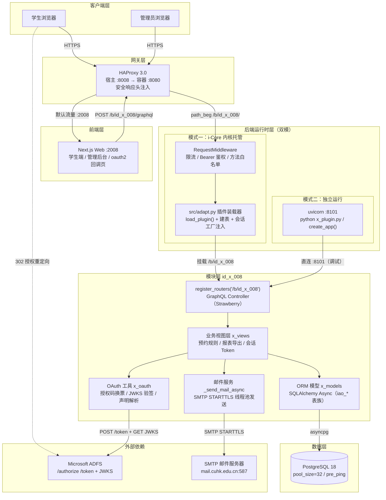
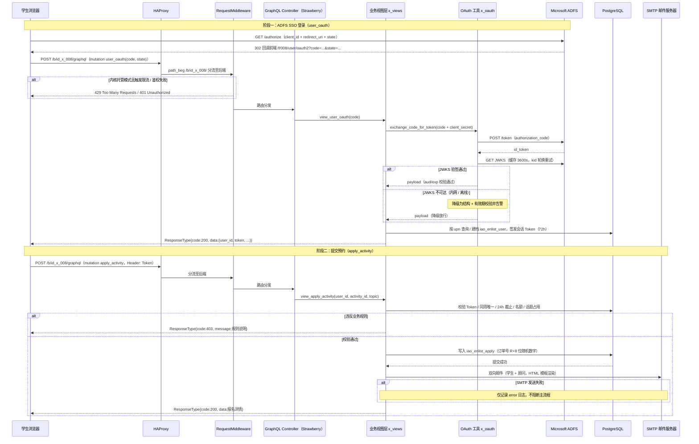

<div align="center">

# id_x_008: IAO 活动预约系统 — 生涯咨询时段预约模块

**单点登录 · 时段预约 · 双向邮件提醒 —— 一站式生涯咨询预约闭环**


</div>

---

## 1. 简介 (Introduction)

- **Slogan**: 单点登录 · 时段预约 · 双向邮件提醒 —— 一站式生涯咨询预约闭环。
- **Description**: id_x_008 是 i-Core 内核的可插拔业务模块，面向高校就业指导中心（IAO）的生涯咨询预约场景。学生经 Microsoft ADFS（Active Directory Federation Services）单点登录后，可在线查看顾问可约时段、自助报名与取消；预约状态每次变更均自动向学生与顾问两侧发送 SMTP 邮件提醒，邮件发送失败仅记录日志、不阻断预约主流程。全部业务查询与变更收敛于单一 Strawberry GraphQL 端点 `/b/id_x_008/graphql`，数据经 SQLAlchemy async ORM + asyncpg 持久化至 PostgreSQL。同一套代码支持双模运行：既可作为 i-Core 引擎插件装载——由内核统一托管路由挂载、连接池注入与 RequestMiddleware 安全中间件（限流/鉴权/方法白名单）；亦可脱离内核独立运行（`python x_plugin.py`），用于本地开发调试，一套代码覆盖「生产托管」与「独立调试」两种形态。模块另附 Next.js 前端（学生端 + 管理后台）、HAProxy 统一入口与 Podman 容器编排，开箱即为完整三层应用。

## 2. 核心特性 (Features)

- ADFS 单点登录：完整 OAuth2 授权码授予流（Authorization Code Grant），服务端以授权码 + client_secret 换取 id_token，经 JWKS 公钥验签与 aud/exp 校验后解析 UPN/email 声明完成建档登录；JWKS 不可达时自动降级为结构 + 有效期校验，保障内网/离线环境可用性。
- 咨询时段预约管理：学生按日历查看顾问可约活动时段并自助报名、取消；内置业务规则引擎——同 ISO 自然周限约 1 次、活动开始前 24 小时截止报名、结束前 4 小时禁止取消、同活动咨询话题唯一占用、名额满自动流转 Full 状态。
- 双向邮件提醒：报名与取消均触发学生侧（Your sign-up / cancellation）与顾问侧（Consultation reservation / cancellation reminder）双向 SMTP 邮件，HTML 模板存于数据库（iao_html_template）可在线维护；另附 cron 脚本实现「开始前一日提醒」与「结束后问卷回访」。
- 单一 GraphQL 端点：21 个 Query 与 13 个 Mutation 全部收敛于 `POST /b/id_x_008/graphql`，统一 `ResponseType{code,message,data}` 响应契约；内置查询深度限制（max_depth=8），生产环境自动禁用 introspection 与 GraphQL IDE。
- 预约数据报表导出：管理后台支持排期模板下载、Excel 批量排期上传、单活动报名明细导出与跨活动报名数据查询/下载（pandas + openpyxl + xlsxwriter，base64 承载文件）。

## 3. 项目亮点 (Highlights)

1. **双模运行架构** —— 同一套插件代码既可由 i-Core 引擎经 `load_plugin()` 装载（复用内核 RequestMiddleware 的限流、Bearer 鉴权与方法白名单），亦可 `python x_plugin.py` 独立启动（uvicorn，默认端口 8101，自动建表并注入会话工厂），生产与调试形态零成本切换。
2. **ADFS SSO 离线降级容错** —— 实现「授权码 → /token 换票 → id_token JWKS 验签」全链路，JWKS 公钥带 3600 秒缓存与 kid 轮换自动刷新重试；网络不可达时降级为结构 + 有效期 + aud 校验并输出告警日志，内网环境登录不中断；身份声明（upn/email/display_name）按候选名自动探测并支持环境变量钉死，适配不同 ADFS 声明规则。
3. **邮件与主流程解耦** —— 报名/取消成功提交后才触发双向邮件，SMTP 阻塞调用经 `asyncio.to_thread` 移入线程池执行，发送失败仅记录 error 日志（"does not affect main flow"），核心事务可用性不受邮件服务波动影响。
4. **工程化连接池调优** —— 异步数据库引擎固定 `pool_size=32`、`pool_recycle=360`、`pool_pre_ping=True`，兼顾并发吞吐与长连接稳定性，断连自动预检重连；数据库凭据支持密文注入（`IAO_DB_ENCRYPTED=true` + `IAO_SECRET_KEY` 自动解密）。
5. **零侵入插件契约** —— 仅实现 `PluginInterface`（`build_tables` / `set_session_maker` / `required_extensions`）与 `register_routers(prefix)`，经 `x_models/_contracts` 运行时校验即可接入内核，不修改内核任何一行代码；ORM Base 与控制器均按需懒加载。
6. **纵深认证安全** —— 管理员口令经 RSA-OAEP 加密传输（`public_key` 查询下发公钥）、PBKDF2-SHA256（600,000 次迭代）哈希存储并兼容旧 SHA-256 迁移；SSO 成功后签发独立 64 位十六进制会话 Token（72 小时有效），不向前端暴露 IdP token；`/token` 请求可选 nonce 防重放（`IAO_OAUTH_NONCE=1`）。
7. **生产级容器编排** —— `ops/up.sh` 一键幂等拉起 Podman Pod（PostgreSQL 18 + 后端 + Next.js 前端 + HAProxy 3.0），数据库端口不对宿主机暴露、服务镜像以非特权 appuser（uid 10001）运行、HAProxy 注入安全响应头并按 `/b/id_x_008/` 前缀分流 API 与前端流量。
8. **依赖安全约束** —— `requirements.txt` 全部依赖采用 `>=x,<y` 兼容性上界，防止意外升级到含 breaking change 或已知漏洞的大版本。

## 4. 技术栈 (Tech Stack)

<p align="center">表 4-1 技术栈一览</p>

| 分类 | 名称 | 版本 | 用途 |
|------|------|------|------|
| 编程语言 | Python | ≥ 3.10 | 后端实现语言 |
| Web 框架 | Litestar[standard] | ≥ 2.0, < 3.0 | 异步 ASGI 框架与路由体系 |
| API 规范 | Strawberry GraphQL[litestar] | ≥ 0.200, < 1.0 | 单一 GraphQL 端点（Litestar 集成） |
| ORM | SQLAlchemy[asyncio] | ≥ 2.0, < 3.0 | 异步 ORM 与数据模型层 |
| 数据库驱动 | asyncpg | ≥ 0.29, < 1.0 | PostgreSQL 异步驱动 |
| 数据库 | PostgreSQL | 18（容器） | 主存储（iao_* 表族，共 7 张表） |
| 数据处理 | pandas / openpyxl / xlsxwriter | ≥ 2.0 / ≥ 3.1 / ≥ 3.1 | Excel 排期上传与报表导出 |
| ASGI 服务器 | uvicorn | ≥ 0.29, < 1.0 | 独立运行模式服务器 |
| 加密 | cryptography | ≥ 42.0, < 45.0 | JWKS RSA 验签、RSA-OAEP 口令解密、凭据解密 |
| 前端框架 | Next.js / React | ^15.3.0 / ^19.0.0 | 学生端与管理后台（端口 2008） |
| 前端组件 | FullCalendar / Quill / Tailwind CSS | ^6.1.15 / ^2.0.2 / ^4.0.0 | 预约日历、富文本编辑、样式体系 |
| 反向代理 | HAProxy | 3.0 | 统一入口、API/前端分流、安全响应头 |
| 容器编排 | Podman / podman-compose | — | Pod 化部署（db / service / web / haproxy） |

## 5. 整体架构图 (Overall Architecture Diagram)



<p align="center">图 5-1 id_x_008 整体架构（双模运行）</p>

## 6. 请求流转图 (Request Flow Diagram)



<p align="center">图 6-1 SSO 登录与预约提交请求流转</p>

## 7. 目录结构 (Directory Structure)

```text
id_x_008/
├── x_plugin.py                        # 插件入口：load_plugin() 返回 PluginInterface；create_app() 构建独立 Litestar 应用（uvicorn :8101）
├── __init__.py                        # 包标识
├── requirements.txt                   # 后端依赖清单（>=x,<y 兼容性上界）
├── LICENSE                            # AGPL-3.0 许可证
├── src/                               # 后端源码（分层：controllers → views → models）
│   ├── controllers/
│   │   └── x_controllers.py           # 路由层：Strawberry Schema（21 Query + 13 Mutation）、深度限制、register_routers(prefix)
│   ├── views/
│   │   └── x_views.py                 # 业务层：预约规则、SSO 登录、邮件通知、Excel 导入导出，异常统一转 ResponseType
│   ├── schemas/
│   │   └── x_schemas.py               # 契约层：GraphQL Input/Type 纯类型定义（ResponseType / FileResponseType 等）
│   ├── models/
│   │   └── x_models.py                # 数据层：7 张 iao_* 表 ORM 模型 + Base + 会话工厂注入
│   └── utils/
│       └── x_oauth.py                 # ADFS OAuth2 客户端：授权码换票、JWKS 验签（降级容错）、身份声明解析
├── utils/                             # 模块级基础工具
│   ├── database_client.py             # 异步引擎与会话工厂（pool_size=32 / pool_recycle=360 / pre_ping）
│   ├── log_util.py                    # 日志与 request_id 上下文
│   ├── encrypt_util.py                # 凭据加密工具（写入侧）
│   ├── decrypt_util.py                # 凭据解密（IAO_DB_ENCRYPTED=true 时启用）
│   └── crypto_util.py                 # RSA-OAEP 口令加解密（配合 public_key 查询）
├── web/                               # Next.js 15 前端（端口 2008）
│   ├── src/app/                       # 页面：login / oauth2 回调 / user（home·activity·records）/ admin（项目·活动·报表导出）
│   ├── src/components/                # 预约日历（FullCalendar）、富文本（Quill）、鉴权守卫等组件
│   ├── src/api/                       # GraphQL 客户端封装（user / admin）
│   └── Dockerfile                     # 前端镜像（构建期内联 NEXT_PUBLIC_* 公开配置，不含 client_secret）
├── ops/                               # 运维资产
│   ├── up.sh                          # Podman Pod 一键启动（幂等；--build 重建镜像）
│   ├── down.sh                        # 一键停止并清理容器与 Pod
│   ├── podman-compose.yml             # compose 编排：db / service / web / haproxy 四容器
│   ├── Dockerfile.service             # 后端镜像（python:3.10-slim，非特权 appuser，HEALTHCHECK /health）
│   ├── haproxy.cfg                    # HAProxy：/b/id_x_008/ 前缀分流 API，默认流量走前端
│   ├── .env.example                   # 环境变量模板（数据库 / 邮件 / OAuth2 / 前端公开配置）
│   └── init/01_seed_admin.sql         # 数据库初始化种子（管理员账号）
├── scripts/                           # cron 定时脚本
│   ├── send_reminder_mail_student.py  # 每日 21:00：向"明日开始"活动的报名学生发提醒邮件
│   ├── send_reminder_mail_advisor.py  # 每日 21:00：向"明日开始"活动的项目顾问发提醒邮件
│   └── send_question_mail.py          # 每 2 小时：活动结束满 2 小时后发问卷邮件（send_question 去重）
├── docs/                              # 用户手册
│   ├── USER-GUIDE-ZH.md               # 中文使用指南
│   └── USER-GUIDE-EN.md               # 英文使用指南
└── logs/                              # 运行日志输出目录（容器挂载 ../logs）
```

## 8. API 接口文档 (API Documentation)

全部对外端点挂载于 `/b/id_x_008` 前缀之下。业务操作统一收敛于单一 GraphQL 端点（`graphql_ide` 关闭、禁止 GET 查询、查询深度上限 8 层、生产环境禁用 introspection）；Schema 配置 `auto_camel_case=False`，操作名与字段名均为 snake_case。OAuth2 回调地址为前端页面（`<BASE_URL>/f/008/user/oauth2`），前端取得授权码后经 `user_oauth` Mutation 回传服务端换票，后端不单独暴露 REST 回调路由。

鉴权体系分两层：内核托管模式下请求先经 i-Core RequestMiddleware 校验 `Authorization: Bearer <TOKEN>`（含限流与方法白名单，异常码 401/405/429）；模块自身业务鉴权使用自有 `Token` 请求头（登录/SSO 后签发的会话 Token，72 小时有效），管理端操作额外校验 admin 角色。业务响应统一为 `ResponseType{code, message, data}`，`data` 为 JSON 字符串需二次解析；常见业务码：200 成功、400 参数/格式错误、401 Token 无效、403 违反业务规则（同周重复/已满/话题占用/取消窗口）、404 记录不存在、500 服务端错误、501 生产环境拒绝 mock SSO。

<p align="center">表 8-1 对外端点汇总</p>

| 方法 | 路径 | 鉴权 | 说明 |
|------|------|------|------|
| GET | /b/id_x_008/health | 免鉴权 | REST 健康检查（独立运行/容器模式由 create_app 注册），返回 {"status":"ok","service":"id_x_008"} |
| POST | /b/id_x_008/graphql | Token 头（业务） | 单一 GraphQL 端点，承载全部 21 个 Query 与 13 个 Mutation |

<p align="center">表 8-2 GraphQL Query 一览（21 个）</p>

| 操作名 | 入参 | 说明 |
|------|------|------|
| health | — | GraphQL 健康检查（HealthType） |
| public_key | — | 获取 RSA 公钥（用于加密登录密码） |
| sso_config | — | 获取 SSO 公开配置（前端初始化调用） |
| get_user_activity_list | UserActivityListInput | 学生端活动分页列表 |
| search_user_activity | SearchUserActivityInput | 活动筛选查询（Open/Full/Closed 状态） |
| get_user_activity_detail | ActivityDetailInput | 活动详情（含话题占用状态） |
| fuzzy_activity_name | FuzzyNameInput | 活动名模糊搜索 |
| get_project_list | PageInput | 项目分页列表（管理端） |
| search_project | SearchProjectInput | 项目查询（管理端） |
| search_project_owner | — | 顾问下拉查询（管理端） |
| get_project_name_list | — | 项目名清单（管理端） |
| get_activity_list | PageInput | 活动分页列表（管理端） |
| get_activity_detail | ActivityIdInput | 单活动报名明细（管理端） |
| search_activity | SearchActivityInput | 活动查询（管理端） |
| get_activity_name_list | ActivityNameListInput | 活动名清单（管理端） |
| fuzzy_export_activity_name | FuzzyNameInput | 导出活动名模糊搜索（管理端） |
| download_activity_template | — | 排期模板下载（Excel，base64） |
| export_activity | ExportActivityInput | 报名数据 Excel 导出（base64） |
| search_query_title | — | 跨活动标题查询（管理端） |
| search_query_data | QueryDataInput | 跨活动报名数据查询（管理端） |
| download_query_data | TitleListInput | 跨活动报名数据下载（Excel，base64） |

<p align="center">表 8-3 GraphQL Mutation 一览（13 个）</p>

| 操作名 | 入参 | 说明 |
|------|------|------|
| login | LoginInput | 管理员账号密码登录（RSA-OAEP 密文优先，403 口令错误） |
| register | RegisterInput | 普通用户注册（邮箱 + 密码至少 8 位，注册即登录） |
| logout | — | 登出（置换会话 Token） |
| user_oauth | OauthInput | SSO 登录回调建档（ADFS 授权码换票 + 验签，401 code 无效） |
| apply_activity | ApplyInput | 提交报名（同周唯一/24h 截止/名额/话题占用校验，违反返回 403） |
| cancel_apply | CancelApplyInput | 取消报名（结束前 4 小时禁取消 403，记录不存在 404） |
| create_project | CreateProjectInput | 新增项目（name 唯一，管理端） |
| update_project | UpdateProjectInput | 编辑项目（管理端） |
| delete_project | ProjectIdInput | 删除项目（级联删除活动与报名，管理端） |
| create_activity | CreateActivityInput | 新增活动时段（管理端） |
| update_activity | UpdateActivityInput | 编辑活动时段（管理端） |
| delete_activity | ActivityIdInput | 删除活动（级联删除报名，管理端） |
| upload_activity | UploadActivityInput | Excel 批量排期上传（.xlsx，400 格式错误，命中即更新） |

该模块未使用 Subscription 类操作。本模块不使用 GraphQL errors 通道表达业务异常，全部业务异常经 `ResponseType.code` 返回。

### 8.1 健康检查示例

```bash
curl "<BASE_URL>/b/id_x_008/health"
# {"status":"ok","service":"id_x_008"}
```

### 8.2 SSO 登录（user_oauth）示例

前端经 ADFS `/authorize` 重定向获得授权码后回传；`<CODE>` / `<STATE>` 为回调参数占位符。

```bash
curl -X POST "<BASE_URL>/b/id_x_008/graphql" \
  -H "Content-Type: application/json" \
  -d '{
    "query": "mutation($input: OauthInput!) { user_oauth(input: $input) { code message data } }",
    "variables": {"input": {"code": "<CODE>", "state": "<STATE>"}}
  }'
```

响应示例（`data` 为 JSON 字符串，客户端需二次解析）：

```json
{
  "data": {
    "user_oauth": {
      "code": 200,
      "message": "success",
      "data": "{\"user_id\": 42, \"name\": \"CHEN,DA WEI(1234567890)\", \"number\": \"1234567890\", \"role\": \"user\", \"token\": \"<SESSION_TOKEN>\"}"
    }
  }
}
```

### 8.3 提交预约（apply_activity）示例

`<SESSION_TOKEN>` 为登录/SSO 签发的会话 Token；内核托管模式下另需 `Authorization: Bearer <KERNEL_TOKEN>`。

```bash
curl -X POST "<BASE_URL>/b/id_x_008/graphql" \
  -H "Content-Type: application/json" \
  -H "Token: <SESSION_TOKEN>" \
  -d '{
    "query": "mutation($input: ApplyInput!) { apply_activity(input: $input) { code message data } }",
    "variables": {"input": {"user_id": 42, "activity_id": "17", "info_1": "Career Planning"}}
  }'
```

### 8.4 学生端活动列表（get_user_activity_list）示例

```bash
curl -X POST "<BASE_URL>/b/id_x_008/graphql" \
  -H "Content-Type: application/json" \
  -H "Token: <SESSION_TOKEN>" \
  -d '{
    "query": "query($input: UserActivityListInput!) { get_user_activity_list(input: $input) { code message data } }",
    "variables": {"input": {"offset": 1, "limit": 10, "fuzzy_name": ""}}
  }'
```

## 9. 快速部署 (Quick Deploy)

### 9.1 环境准备 (Prerequisites)

- Python ≥ 3.10（后端）
- PostgreSQL（容器编排默认 18；需可达的 `DB_HOST/DB_PORT/DB_NAME/DB_USERNAME/DB_PASSWORD`）
- Node.js ≥ 24 与 npm（可选，仅本地开发前端时需要）
- Podman 与 podman-compose（可选，容器部署时需要）

### 9.2 安装 (Installation)

```bash
# 位于 i-Core 仓库根目录
cd i-Core

# 安装模块后端依赖
pip install -r x_models/id_x_008/requirements.txt

# （可选）前端本地开发依赖
cd x_models/id_x_008/web && npm ci
```

### 9.3 运行 (Run)

方式一：独立运行（本地调试，默认端口 8101，启动时自动建表）：

```bash
# 注入数据库连接（或写入 ops/.env 后 source）
export DB_HOST=127.0.0.1 DB_PORT=5432 DB_NAME=id_x_008 \
       DB_USERNAME=postgres DB_PASSWORD=<DB_PASSWORD>

# 从仓库根目录启动（IAO_PORT 可覆盖端口）
python x_models/id_x_008/x_plugin.py

# 验证
curl http://127.0.0.1:8101/b/id_x_008/health
```

独立运行模式未启用安全加固（CORS/限速等），仅用于开发调试；生产环境请经 i-Core 引擎加载或使用容器编排。

方式二：i-Core 内核托管（生产形态）——在 `config/base_config.toml` 的 `[EXTEND].MODELS` 中声明 `["id_x_008", "id_x_008"]` 后启动内核，内核自动完成插件装载、建表、会话工厂注入与路由挂载（`/b/id_x_008`），并统一施加 RequestMiddleware 限流/鉴权。

常用环境变量：`IAO_PORT`（独立运行端口，默认 8101）、`IAO_ENV`（production 时禁用 introspection 与 mock SSO）、`IAO_MAIL_SERVER/IAO_MAIL_PORT/IAO_MAIL_USER/IAO_MAIL_FROM/IAO_MAIL_PASSWORD`（SMTP）、`IAO_OAUTH_CLIENT_ID/IAO_OAUTH_CLIENT_SECRET/IAO_OAUTH_REDIRECT_URI/IAO_OAUTH_BUSINESS_URL`（SSO 必填）、`IAO_OAUTH_ADFS_BASE/IAO_OAUTH_ADFS_DISCOVERY_URL/IAO_OAUTH_ADFS_JWKS_URL`（ADFS 端点覆盖）、`IAO_OAUTH_UPN_CLAIM/IAO_OAUTH_EMAIL_CLAIM/IAO_OAUTH_CLOCK_SKEW_SECONDS/IAO_OAUTH_NONCE`（声明适配）、`IAO_DB_ENCRYPTED/IAO_SECRET_KEY`（凭据密文）。完整清单见 `ops/.env.example`。

### 9.4 容器部署 (Podman)

一键启动（Pod 模式，推荐）：

```bash
cd x_models/id_x_008/ops

# 首次执行自动生成 .env（由 .env.example 复制），修改后重新执行
./up.sh

# 重建镜像并启动
./up.sh --build

# 访问入口（HAProxy 统一分流：/b/id_x_008/ → 后端 :8101，其余 → 前端 :2008）
curl http://localhost:8008/b/id_x_008/health

# 停止并清理
./down.sh
```

或使用 podman-compose：

```bash
cd x_models/id_x_008/ops
cp .env.example .env    # 修改数据库口令、邮件口令与 OAuth2 凭据
podman-compose up -d
podman-compose down
```

编排包含四个容器：`id_x_008_db`（PostgreSQL 18，端口不对宿主机暴露，`ops/init/01_seed_admin.sql` 初始化管理员）、`id_x_008_service`（后端，非特权 appuser，内置 `/b/id_x_008/health` 健康检查）、`id_x_008_web`（Next.js，构建期以 `--build-arg` 内联 `NEXT_PUBLIC_ADFS_*` 公开配置，不含 client_secret）、`id_x_008_haproxy`（宿主 8008 → 容器 8080）。日志挂载至宿主机 `x_models/id_x_008/logs/`（目录需对 uid 10001 可写）。

定时任务（可选，经 crontab 挂载）：

```bash
# 每日 21:00 学生/顾问提醒；每 2 小时问卷回访
0 21 * * *  python x_models/id_x_008/scripts/send_reminder_mail_student.py
0 21 * * *  python x_models/id_x_008/scripts/send_reminder_mail_advisor.py
0 */2 * * * python x_models/id_x_008/scripts/send_question_mail.py
```
