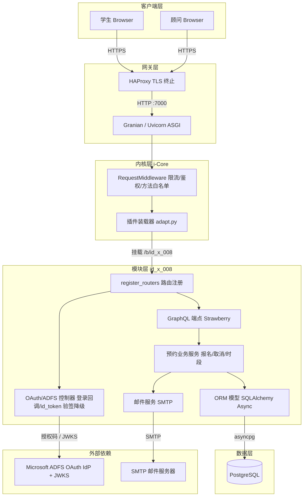
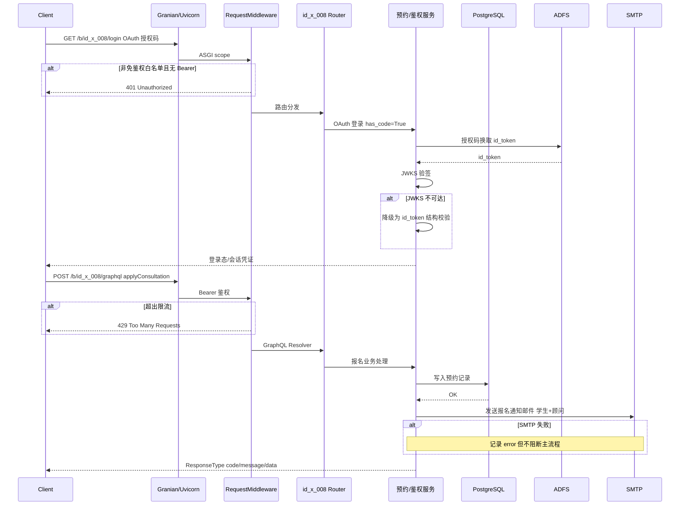

<div align="center">

# id_x_008: 高校职业咨询预约与通知模块

**单点登录 · 时段预约 · 双向邮件通知 —— 职业咨询预约一站式闭环**


</div>

---

## 1. 简介 (Introduction)

- **Slogan**: 单点登录 · 时段预约 · 双向邮件通知 —— 职业咨询预约一站式闭环。
- **Description**: id_x_008 是 i-Core 内核的可插拔业务模块，面向高校就业指导中心的职业咨询预约场景。模块通过 Microsoft ADFS（Active Directory Federation Services，活动目录联合服务）OAuth 实现单点登录，学生可在线查看顾问可约时段并完成报名与取消，系统在预约状态变更时自动向学生与顾问双方发送 SMTP 邮件提醒。模块以 Strawberry GraphQL 单端点对外暴露全部业务查询与变更，数据经 SQLAlchemy 异步 ORM 持久化至 PostgreSQL。模块既可作为 i-Core 引擎插件由内核统一托管路由、数据库连接池与安全中间件，也可脱离内核独立运行以供本地开发调试，同一份代码覆盖「生产托管」与「独立调试」两套部署形态。

## 2. 核心特性 (Features)

- ADFS 单点登录：完整 OAuth 授权码流程，以授权码换取 id_token 并完成 JWKS 验签，解析 UPN（User Principal Name，用户主体名称）声明确定身份。
- 咨询预约管理：学生可查看顾问可约时段并完成报名与取消，时段与预约记录经异步 ORM 持久化至 PostgreSQL。
- 双向邮件通知：报名与取消触发双向 SMTP 邮件，分别通知学生（"Your sign-up / cancellation"）与顾问（"Consultation reservation / cancellation reminder"）。
- GraphQL 单端点：基于 Strawberry GraphQL 的 Litestar 集成，全部业务查询与变更统一收敛至 `/b/id_x_008/graphql`。
- 数据导入导出：依托 pandas、openpyxl、xlsxwriter 支持预约数据的 Excel 处理与报表导出。

## 3. 项目亮点 (Highlights)

1. **双模运行架构** —— 同一份插件代码即可作为 i-Core 引擎插件运行（复用内核限流、Bearer 鉴权、方法白名单等安全中间件），又可经 `python x_plugin.py` 独立起服（默认端口 8101），生产与本地调试零摩擦切换。
2. **ADFS SSO 降级容错** —— 完整实现 ADFS「授权码 → id_token → JWKS 验签」链路；当 ADFS JWKS 端点不可达时自动降级为 id_token 结构校验，保证内网或离线环境下登录不中断（运行日志可见降级路径与 UPN 声明解析结果）。
3. **邮件通知与主流程解耦** —— 报名与取消触发学生、顾问双向邮件，SMTP 失败仅记录 error 且不阻断预约主流程，保障核心交易可用性（日志中"does not affect main flow"即此设计）。
4. **连接池工程化调优** —— 异步数据库引擎采用 `pool_size=32`、`pool_recycle=360`、`pool_pre_ping` 配置，兼顾并发吞吐与长连接稳定性，并对断连做预检重连。
5. **插件契约零侵入** —— 仅实现 `PluginInterface`（`build_tables` / `set_session_maker` / `required_extensions`）与 `register_routers(prefix)`，经 `x_models._contracts` 运行时校验即可接入内核，无需修改内核任何一行代码。
6. **依赖安全约束** —— `requirements.txt` 全部依赖采用 `>=x,<y` 兼容性上界，防止意外升级至含 breaking change 或已知漏洞的主版本。
7. **懒加载模块隔离** —— ORM Base 与控制器均按需导入，独立运行时无需引擎环境即可起服；会话工厂由内核建表后注入，模块不自行管理连接池生命周期。

## 4. 技术栈 (Tech Stack)

<p align="center">表 4-1 技术栈一览</p>

| 分类 | 名称 | 版本 | 用途 |
|------|------|------|------|
| 编程语言 | Python | ≥ 3.10 | 全栈实现语言 |
| Web 框架 | Litestar[standard] | ≥ 2.0, < 3.0 | 异步 ASGI 框架与路由体系 |
| API 规范 | Strawberry GraphQL | ≥ 0.200, < 1.0 | GraphQL 端点（Litestar 集成） |
| ORM | SQLAlchemy[asyncio] | ≥ 2.0, < 3.0 | 异步 ORM 与模型层 |
| 数据库驱动 | asyncpg | ≥ 0.29, < 1.0 | PostgreSQL 异步驱动 |
| 数据库 | PostgreSQL | — | 主存储 |
| 数据处理 | pandas / openpyxl / xlsxwriter | ≥ 2.0 / ≥ 3.1 / ≥ 3.1 | Excel 导入导出与报表 |
| ASGI 服务器 | uvicorn | ≥ 0.29, < 1.0 | 独立运行模式服务器 |
| 加密 | cryptography | ≥ 42.0, < 45.0 | 配置与密钥加密 |

## 5. 整体架构图 (Overall Architecture Diagram)



<p align="center">图 5-1 id_x_008 整体架构图</p>

## 6. 请求流转图 (Request Flow Diagram)



<p align="center">图 6-1 请求流转图</p>

## 7. 目录结构 (Directory Structure)

```text
id_x_008/
├── x_plugin.py              # 插件入口：load_plugin() 返回 PluginInterface 实例；create_app() 构建独立 Litestar 应用
├── __init__.py              # 包标识
├── requirements.txt         # 模块独立依赖清单（>=x,<y 兼容性上界）
├── LICENSE                  # AGPL-3.0 许可证
├── src/                     # 源代码目录
│   ├── models/              # SQLAlchemy ORM 模型层
│   │   └── x_models.py      # Base 元数据、set_session_maker() 会话工厂注入
│   └── controllers/         # 路由与 GraphQL 控制器
│       └── x_controllers.py # register_routers(prefix) 注册 OAuth 路由与 GraphQL 端点
├── utils/                   # 模块级工具
│   └── database_client.py   # get_engine() / get_session_maker() 异步数据库客户端
├── web/                     # 前端资源目录（预留）
├── docs/                    # 模块文档目录
├── ops/                     # 运维资产目录
├── scripts/                 # 辅助脚本目录
└── logs/                    # 运行日志输出目录（id_x_008.log）
```

## 8. API 接口文档 (API Documentation)

模块对外端点统一挂载于 `/b/id_x_008` 前缀之下。其中 `health` 与 `graphql` 端点由 `x_plugin.py` 显式注册；OAuth 登录与回调路由由 `src/controllers` 注册，具体路径以控制器实现为准。经 i-Core 引擎加载时，全部请求先经内核 `RequestMiddleware`（限流、Bearer 鉴权、GET/POST/OPTIONS 方法白名单）。

<p align="center">表 8-1 端点汇总</p>

| 方法 | 路径 | 鉴权 | 说明 |
|------|------|------|------|
| GET | /b/id_x_008/health | 免鉴权 | 健康检查，返回 {"status":"ok","service":"id_x_008"} |
| GET | /b/id_x_008/login | 免鉴权 | OAuth/ADFS 登录入口，重定向至 ADFS 授权页 |
| GET | /b/id_x_008/callback | 免鉴权 | OAuth 回调，以授权码换取 id_token 并建立会话 |
| POST | /b/id_x_008/graphql | Bearer | GraphQL 单端点，承载全部业务查询与变更 |

<p align="center">表 8-2 GraphQL 操作一览</p>

| 类型 | 操作 | 说明 |
|------|------|------|
| Query | availableSlots | 查询顾问可预约时段 |
| Query | myReservations | 查询当前学生的预约记录 |
| Query | advisors | 查询顾问列表 |
| Mutation | oauthLogin | 以 ADFS 授权码换取会话凭证 |
| Mutation | applyConsultation | 报名一场咨询 |
| Mutation | cancelConsultation | 取消已有预约 |

注：上表操作名为按业务能力归纳的示意命名，权威 Schema 定义由 Strawberry 在 `/b/id_x_008/graphql` 端点生成，可通过内省（introspection）获取完整字段定义。响应统一封装为 `ResponseType(code, message, data)`；内核级异常码为 401（未鉴权）、405（方法不允许）、429（触发限流），业务级异常码以模块返回为准。

健康检查：

```bash
curl "<BASE_URL>/b/id_x_008/health"
# {"status":"ok","service":"id_x_008"}
```

Schema 内省：

```bash
curl -X POST "<BASE_URL>/b/id_x_008/graphql" \
  -H "Content-Type: application/json" \
  -H "Authorization: Bearer <TOKEN>" \
  -d '{"query":"query { __schema { queryType { name } mutationType { name } } }"}'
```

报名咨询（applyConsultation）：

```bash
curl -X POST "<BASE_URL>/b/id_x_008/graphql" \
  -H "Content-Type: application/json" \
  -H "Authorization: Bearer <TOKEN>" \
  -d '{"query":"mutation { applyConsultation(input: { slotId: \"<SLOT_ID>\" }) { code message data { reservationId status } } }"}'
```

取消预约（cancelConsultation）：

```bash
curl -X POST "<BASE_URL>/b/id_x_008/graphql" \
  -H "Content-Type: application/json" \
  -H "Authorization: Bearer <TOKEN>" \
  -d '{"query":"mutation { cancelConsultation(input: { reservationId: \"<RESERVATION_ID>\" }) { code message } }"}'
```

## 9. 快速部署 (Quick Deploy)

### 9.1 环境准备 (Prerequisites)

- Python ≥ 3.10
- PostgreSQL（建议 ≥ 14）
- Microsoft ADFS OAuth 凭据（client_id / client_secret / redirect_uri / 授权与令牌端点 / JWKS URI）
- 可达的 SMTP 邮件服务（发件账号与凭证）
- uv（推荐）或 pip

### 9.2 安装 (Installation)

作为 i-Core 子模块随内核安装：

```bash
git clone <REPO_URL> i-Core
cd i-Core
uv sync
```

或仅安装本模块依赖（独立运行）：

```bash
cd x_models/id_x_008
pip install -r requirements.txt   # 或 uv pip install -r requirements.txt
```

### 9.3 运行 (Run)

引擎插件模式（生产，复用内核安全中间件与连接池托管）：

```text
# config/base_config.toml
[EXTEND]
MODELS = [
    ["id_x_008", "/id_x_008"],
]
```

```bash
uv run python main.py
```

独立运行模式（本地调试，默认端口 8101）：

```bash
IAO_PORT=8101 python x_models/id_x_008/x_plugin.py
```

独立模式启动时会以 `RuntimeWarning` 提示未启用安全加固（CORS、限流等），生产环境请通过 i-Core 引擎加载。

<p align="center">表 9-1 配置项清单</p>

| 配置组 | 说明 | 必填 |
|------|------|------|
| 数据库连接 | PostgreSQL host / port / db / user / password，经 i-Core 分层 .env 提供 | 是 |
| ADFS OAuth | client_id / client_secret / redirect_uri / 授权端点 / 令牌端点 / JWKS URI | 是 |
| SMTP 邮件 | host / port / 账号 / 凭证 / 发件人地址 | 是 |
| 运行端口 | IAO_PORT（独立模式，默认 8101） | 否 |

### 9.4 容器部署 (可选)

独立模式的容器化示例（适配 Podman / Docker）：

```dockerfile
FROM docker.io/python:3.12-slim
WORKDIR /app
COPY requirements.txt .
RUN pip install --no-cache-dir -r requirements.txt
COPY . .
ENV IAO_PORT=8101
EXPOSE 8101
CMD ["python", "x_plugin.py"]
```

```bash
podman build -t id_x_008:latest x_models/id_x_008
podman run --rm -p 8101:8101 --env-file .env id_x_008:latest
```

生产部署建议将本模块交由 i-Core 引擎进程统一加载（Granian 多 worker 托管），并于前置 HAProxy 完成 TLS 终止与反向代理，而非直接暴露独立模式容器。
